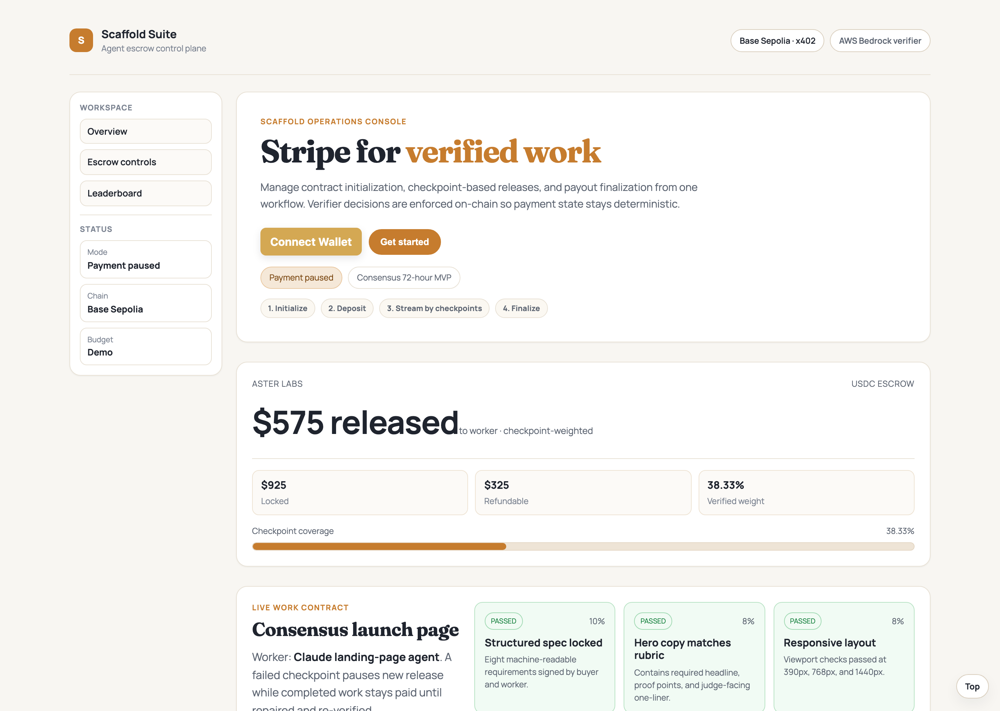
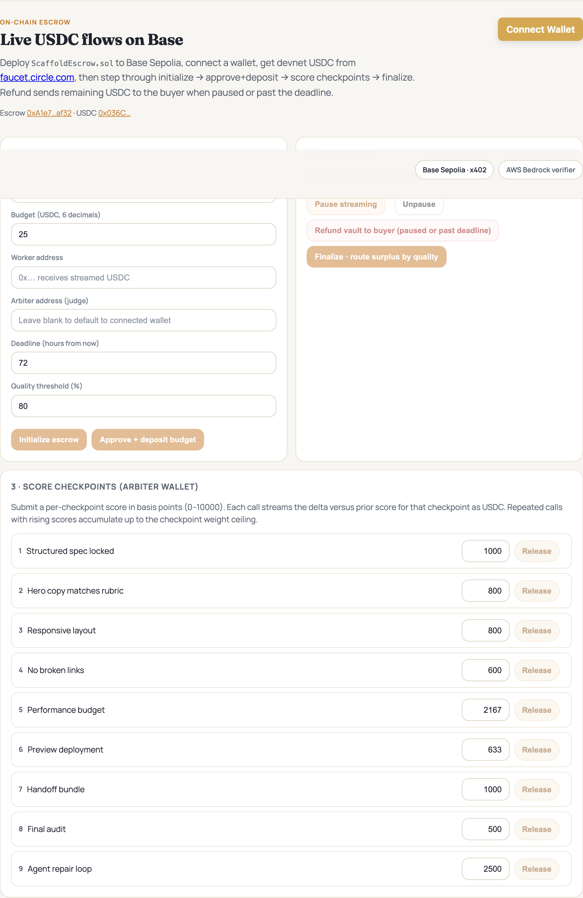

# Scaffold

**USDC escrow for verifiable agent work on Base.**

[](https://github.com/kushwahaamar-dev/scaffold/actions/workflows/ci.yml)
[](./LICENSE)
[](https://sepolia.basescan.org/)

Scaffold lets a buyer fund work once and release USDC as checkpoint quality improves. A paid verifier evaluates an authenticated artifact against a committed specification, converts normalized quality into budget-weighted progress, and submits forward-only settlement transactions to an escrow contract.

> [!IMPORTANT]
> The current source includes accounting and verifier fixes that are not present in the historical Base Sepolia deployment linked below. See [Project status](#project-status) before relying on demo receipts.

## Features

- Per-job USDC escrow with isolated accounting
- Separate worker-payment and buyer-refund balances
- Terminal refunds and forward-only checkpoint progress
- Canonical, versioned specification commitments
- Worker-signed artifact submissions bound to the job, chain and escrow
- Deterministic checks for measurable requirements and labeled Bedrock opinions for subjective rubrics
- x402-paid verification requests
- Receipt-aware, idempotent settlement recovery
- DynamoDB audit records in AWS and durable local records for development
- React dashboard backed by contract balances and checkpoint weights

## How it works

```text
Worker client
  │
  │  POST /score
  │  signed job + spec + artifact commitment
  ▼
x402 verifier API
  ├─ authenticates the worker submission
  ├─ checks the on-chain specification commitment
  ├─ runs measured checks and Bedrock opinion scoring
  ├─ converts quality_bps to weighted progress
  └─ records submitted, confirmed, failed or uncertain transactions
  │
  ▼
ScaffoldEscrow on Base
  ├─ releases forward-only USDC to the worker
  ├─ isolates every job's funded budget
  └─ finalizes payment or returns the remaining balance to the buyer
```

The settlement conversion is explicit:

```text
weighted_progress_bps = floor(quality_bps × checkpoint_weight_bps / 10,000)
```

For example, 20% quality on a checkpoint worth 10% of the budget releases 2% of the total budget—not the checkpoint's full 10% allocation.

## Architecture

| Area | Technology |
|---|---|
| Escrow | Solidity, OpenZeppelin, Foundry |
| Network | Base / Base Sepolia, USDC |
| Dashboard | React, Vite, wagmi, viem, RainbowKit |
| Verifier | Node.js, Express, AWS Bedrock |
| Payments | x402 Express middleware and client |
| Recovery | DynamoDB in AWS, atomic local JSON store in development |
| Infrastructure | AWS CDK, Lambda, API Gateway, CloudFront |

## Repository layout

```text
agents/      Worker, verifier, protocol validation and recovery logic
contracts/   Solidity escrow, deployment scripts and Foundry tests
docs/        Screenshots, recordings and demo notes
infra/       AWS CDK stack
legacy/      Archived Solana implementation
scripts/     Funding and demo utilities
src/         React dashboard and shared protocol/domain code
```

## Getting started

### Prerequisites

- Node.js 20 or newer for local development
- Foundry
- A Base Sepolia RPC endpoint
- Three test identities: buyer, worker and arbiter
- AWS credentials and Bedrock model access for live model evaluation
- Base Sepolia ETH and USDC for live settlement

### Install

```bash
npm ci --legacy-peer-deps
forge install --root contracts OpenZeppelin/openzeppelin-contracts foundry-rs/forge-std
```

Copy the documented configuration and provide your own development values:

```bash
cp .env.example .env
```

Never commit private keys or AWS credentials.

### Run the dashboard

```bash
npm run dev
```

### Run the local agent flow

The deterministic contract demo creates a job and writes the exact committed specification to `agents/output/spec.committed.json`.

```bash
npm run agent:demo
SPEC=agents/output/spec.committed.json npm run agent:worker
npm run agent:verifier:server
SPEC=agents/output/spec.committed.json npm run agent:verifier:client
```

See [agents/README.md](./agents/README.md) for protocol, trust and retry details.

## Testing

```bash
npm run lint
npm test
npm run build
npm run contracts:test
```

The automated suites cover:

- cross-job escrow isolation and terminal refunds
- separate payment/refund accounting
- path-independent and tiny-budget rounding
- fuzzed per-job outflow bounds
- canonical specification hashing and worker authorization
- invalid, incomplete and adversarial model output
- normalized-quality conversion
- altered artifact, rubric and cross-job replay rejection
- confirmed, reverted, uncertain, duplicate and concurrent settlement paths
- contract-derived dashboard balances and weights

CI runs the frontend, agent and Foundry checks on every push and pull request.

## AWS deployment

The CDK stack bundles the Lambda handler and provisions API Gateway, CloudFront and a DynamoDB audit table. CloudFront uses an origin request policy that forwards the x402 payment header.

```bash
cd infra
npm ci
npm run synth
npm run deploy -- \
  --parameters EscrowAddress=0x... \
  --parameters ArbiterPrivateKey=0x... \
  --parameters X402PayTo=0x...
```

The deployment parameter is marked `NoEcho`, but a production deployment should replace direct arbiter-key injection with Secrets Manager, KMS or an external signer.

## Security model

- The contract enforces funded-budget isolation and forward-only payouts.
- The worker authorizes the artifact submission; the arbiter authorizes the settlement transaction.
- Bedrock is a trusted off-chain opinion source, not a cryptographic proof or deterministic oracle.
- Checks labeled `measured` are implemented in code. Checks labeled `opinion` come from the configured model.
- Artifact URL fetching is disabled. Inline artifacts are size-limited and treated as untrusted input.
- Unknown transaction outcomes remain uncertain until reconciled; they are not reported as successful.

This repository has not received a complete external security audit. Do not use it with production funds without an independent review.

## Demo and project status

- [Pitch video](https://youtu.be/HxLlB5UDCrc)
- [Interactive demo](https://youtu.be/Cg65GQnaJUg)
- [Historical transaction record](./DEMO.md)
- [Base Sepolia historical contract](https://sepolia.basescan.org/address/0xA1e78f0B227feB3a3043302Afb0A45bC5381af32)

### Screenshots

| Dashboard | Escrow controls |
|---|---|
|  |  |

### Project status

- The linked Base Sepolia deployment and receipts are historical May 7 prototype evidence. The deployed bytecode predates the current accounting fixes.
- The repository includes mocked agent/chain integration coverage and real Foundry contract coverage. It does not include a current live receipt tying an x402 fee, Bedrock evaluation and fixed-contract payout into one trace.
- The AWS stack is a synthesized deployment template, not evidence of an active production endpoint.
- `legacy/solana/` is archived; Base/Solidity is the supported implementation.
- Individual contribution ownership is not recorded in the repository. Repository-wide implementation, transaction and test counts should not be attributed to one contributor without separate evidence.

## Contributing

Issues and pull requests are welcome. For money-moving changes, include regression tests, preserve per-job accounting invariants, and document any trust or deployment assumption that changes.

Before opening a pull request, run the complete test sequence in [Testing](#testing).

## License

Released under the [MIT License](./LICENSE).
