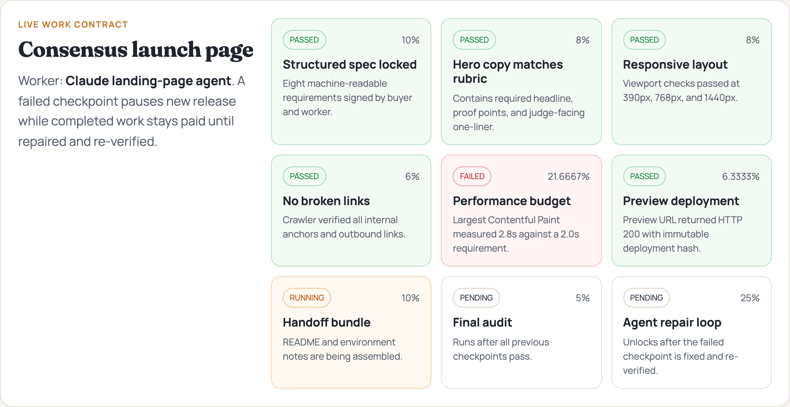
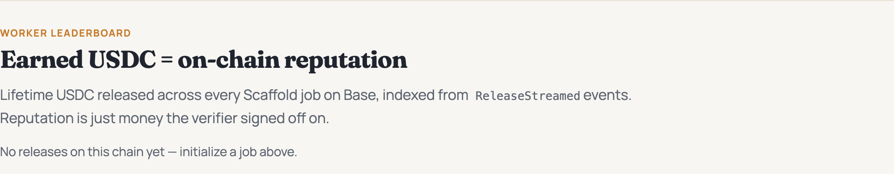

# Scaffold

> Stripe for verified work. AI freelancers get paid on Base as quality improves.

[](https://github.com/kushwahaamar-dev/scaffold/actions/workflows/ci.yml)

## What this project does

Scaffold fixes a trust gap in AI freelancing. Buyers do not want to pay full amount before quality is proven, and workers do not want to wait forever to get paid.

We solve this with a Base escrow contract that streams USDC as checkpoint quality improves. When x402 is configured, scoring runs through a paid verifier API and confirmed progress can settle on chain.

## Videos

- Video pitch: [https://youtu.be/HxLlB5UDCrc](https://youtu.be/HxLlB5UDCrc)
- Interactive demo: [https://youtu.be/Cg65GQnaJUg](https://youtu.be/Cg65GQnaJUg)

Local recordings are also in `docs/demo-video/`.

## Screenshots

| | |
|---|---|
|  | Hero and wallet connection flow |
|  | Checkpoint state board driven by on-chain reads |
|  | On-chain controls for initialize, deposit, stream, pause, finalize |
|  | Worker reputation based on lifetime released USDC |

Full page: [`docs/screenshots/dashboard-full.png`](./docs/screenshots/dashboard-full.png)

## Technical architecture

### Stack

- Smart contracts: Solidity + Foundry on Base Sepolia
- Frontend: React + Vite + wagmi + viem + RainbowKit
- Verifier API: Node + Express + `x402-express` + AWS Bedrock
- Worker client: `x402-fetch` for paid requests to verifier
- Infra template: AWS CDK (Lambda, API Gateway, CloudFront, DynamoDB)

### System diagram

```text
   ┌──────────────┐    POST /score (HTTP 402)        ┌────────────────────┐
   │  Worker      │ ───────────────────────────────► │  AWS API Gateway   │
   │  agent       │                                  │  → Lambda          │
   │  (artifact)  │ ◄── 402 + accepts[USDC, base]    │  (verifier server) │
   │              │ ─── X-PAYMENT header ──────────► │                    │
   │              │ ◄── 200 {scores, txs}            │  · x402-express    │
   └──────┬───────┘                                  │  · Bedrock runtime │
          │                                          │  · viem write tx   │
          │ x402 facilitator settles USDC            └─────────┬──────────┘
          ▼                                                    │
   ┌────────────────────────── Base Sepolia ───────────────────▼────────────┐
   │  USDC                             ScaffoldEscrow.sol                   │
   │                                    · releaseStreamed(jobId, idx, bps)  │
   │                                    · forward-progress only              │
   │                                    · permissionless finalizeJob         │
   └──────────────────────────────────────────────────────────────────────────┘
```

### Core flow

1. Buyer creates a job and deposits USDC into `ScaffoldEscrow`.
2. Worker submits artifact for evaluation.
3. Verifier endpoint returns HTTP 402 if unpaid.
4. Worker pays via x402 and retries.
5. Deterministic checks measure objective requirements; Bedrock supplies explicitly labeled opinions for subjective rubrics.
6. The verifier converts normalized quality into checkpoint-weighted progress, waits for successful receipts, and records recovery state in DynamoDB or a local audit file.
7. Anyone can call `finalizeJob` after deadline or full scoring.

### Why sponsor tech matters

- x402 makes verifier calls natively payable per request.
- Base makes repeated USDC settlement cheap and fast.
- AWS Bedrock provides structured scoring that maps directly to checkpoint release logic.

## Repository structure

```text
contracts/   Solidity escrow and tests
src/         React dashboard
agents/      Worker + verifier services
infra/       AWS CDK deployment
docs/        Demo media and screenshots
```

## Quick start

```bash
npm ci --legacy-peer-deps
forge install --root contracts OpenZeppelin/openzeppelin-contracts foundry-rs/forge-std
npm run contracts:build
npm run contracts:test
npm test
npm run dev
```

## Current guarantees and limits

- The current contract keeps worker payments and buyer refunds separate, makes refunds terminal, and prevents one job from spending another job's deposit.
- Specifications use one canonical `scaffold-spec-v1` hash across the dashboard and agents. Worker signatures bind each artifact to its job, spec, chain and escrow.
- The verifier is a trusted off-chain arbiter. Model opinions are not proofs; only checks labeled `measured` are deterministic code checks.
- Paid settlement fails closed without x402 configuration. Confirmed, failed and uncertain transaction outcomes are stored for idempotent retry.
- The AWS stack is a deployable template, not evidence of a currently running production service. Deployment still requires addresses, secrets, Bedrock access and x402 configuration.
- The CDK template accepts the arbiter key as a NoEcho deployment parameter for reproducibility. A production deployment should replace that with Secrets Manager or KMS-backed signing.
- The Base Sepolia address and receipts in `DEMO.md` are historical evidence from the May 7 prototype. Its immutable bytecode predates the accounting fixes in this repository.
- `legacy/solana/` is archived reference code. The supported implementation is Base/Solidity.

## Contribution provenance

This repository does not contain an evidence-backed split of Laksh Kumar's individual work versus team work. Do not attribute repository-wide implementation, transaction or test counts to him in a resume or interview until that ownership record is added separately.

For full demo receipts and transaction links, see [`DEMO.md`](./DEMO.md).

## Submission links

- BaseScan contract: [https://sepolia.basescan.org/address/0xA1e78f0B227feB3a3043302Afb0A45bC5381af32](https://sepolia.basescan.org/address/0xA1e78f0B227feB3a3043302Afb0A45bC5381af32)
- Canva slides: [https://canva.link/nh4zk5ibbxukkrs](https://canva.link/nh4zk5ibbxukkrs)

## License

MIT. See [`LICENSE`](./LICENSE).
